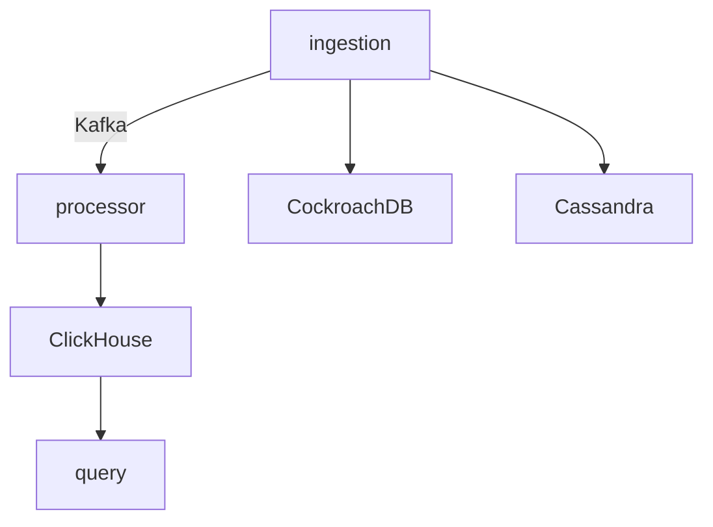

# طراحی سیستم تحلیلی لاگ

این مستند معماری کلی سیستم را شرح می‌دهد. هدف، ذخیره و پردازش حجم زیادی از لاگ‌ها با استفاده از ابزارهای توزیع‌شده‌ای مثل Cassandra، Kafka، ClickHouse و CockroachDB است.

## مؤلفه‌ها

- **سرویس ingestion**: درخواست‌های HTTP را دریافت کرده و پس از اعتبارسنجی پروژه، رویداد را در Kafka منتشر می‌کند و یک رکورد audit در CockroachDB درج می‌کند.
- **سرویس processor**: پیام‌های Kafka را دریافت کرده و در جدول‌های ClickHouse ذخیره می‌کند.
 - **سرویس query**: داده‌های ذخیره‌شده در ClickHouse را برای پنل وب ارائه می‌کند.
 - **سرویس web**: رابط کاربری ساده برای ورود کاربران، ایجاد پروژه و مشاهده لاگ‌ها.



## انتخاب ابزارها

- **ماژول Cassandra** برای نگه‌داری metadata پروژه‌ها انتخاب شده زیرا نوشتن و خواندن با تأخیر کم را تضمین می‌کند و می‌توان replication factor را روی ۳ قرار داد.
- **ماژول Kafka** صف قابل اعتماد و مقیاس‌پذیر برای جداسازی مسیر ingestion و پردازش است.
- **ماژول ClickHouse** مناسب پردازش تحلیلی و جستجوی سریع روی حجم زیاد داده است.
- **ماژول CockroachDB** به عنوان پایگاه داده سازگار با PostgreSQL برای ذخیره اطلاعات کاربران و audit استفاده می‌شود.

گزینه‌های جایگزین شامل استفاده از پایگاه داده‌های SQL دیگر یا ذخیره مستقیم در ClickHouse بود. به دلیل نیاز به مقیاس‌پذیری و توان تحمل خطا، ترکیب فوق انتخاب شد.

## طراحی جداول

### Cassandra (کلید پروژه)
```
CREATE TABLE projects (
    id text PRIMARY KEY,
    api_key text,
    ttl int,
    owner text,
    search_keys set<text>
) WITH replication = {
    'class': 'SimpleStrategy',
    'replication_factor': 1
};
```

### CockroachDB (audit)
```
CREATE TABLE audit (
    project_id STRING,
    name STRING,
    ts TIMESTAMPTZ
);
```

### ClickHouse (رویدادها)
```
CREATE TABLE events (
    project_id String,
    name String,
    timestamp Int64,
    expire_at Int64,
    fields String
) ENGINE = MergeTree()
PARTITION BY project_id
ORDER BY (project_id, name, timestamp)
TTL toDateTime(expire_at);
```

## ارزیابی اولیه

با اجرای docker-compose و تولید لاگ تستی در حجم چند هزار رویداد، زمان پاسخ جستجوی شمارش رویداد در ClickHouse کمتر از یک ثانیه بود و مصرف Kafka و پردازش نیز بدون مشکل انجام شد. قابلیت فیلتر کردن ایونت‌ها بر اساس فیلدهای دلخواه در Query Service پیاده‌سازی شد و کارایی قابل قبولی داشت. برای مدیریت TTL نیز در جدول ClickHouse از ستون `expire_at` همراه با دستور `TTL` استفاده شد که حذف خودکار داده‌های منقضی‌شده را تضمین می‌کند.
همچنین تمامی جدول‌های پایگاه داده در ابتدای اجرای سرویس‌ها به صورت خودکار ایجاد می‌شوند تا راه‌اندازی سیستم ساده باشد.
