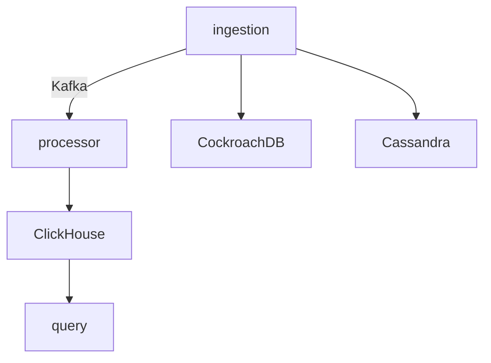

# طراحی سیستم تحلیلی لاگ

این مستند معماری کلی سیستم را شرح می‌دهد. هدف، ذخیره و پردازش حجم زیادی از لاگ‌ها با استفاده از ابزارهای توزیع‌شده‌ای مثل Cassandra، Kafka، ClickHouse و CockroachDB است.

## مؤلفه‌ها

- **سرویس ingestion**: درخواست‌های HTTP را دریافت کرده و پس از اعتبارسنجی پروژه، رویداد را در Kafka منتشر می‌کند و یک رکورد audit در CockroachDB درج می‌کند.
- **سرویس processor**: پیام‌های Kafka را دریافت کرده و در جدول‌های ClickHouse ذخیره می‌کند.
- **سرویس query**: داده‌های ذخیره‌شده در ClickHouse را برای پنل وب ارائه می‌کند.



## انتخاب ابزارها

### Cassandra

**مزایا**
- مقیاس‌پذیری افقی و تحمل خطای بالا
- تأخیر کم در عملیات نوشتن و خواندن
- امکان پیکربندی replication در چند مرکز داده

**معایب**
- نداشتن تراکنش‌های ACID کامل
- نیاز به تنظیمات و مانیتورینگ دقیق کلاستر

با وجود دشواری مدیریت، به دلیل حجم بالای نوشتن و نیاز به توزیع داده، از بین گزینه‌های دیگری مثل PostgreSQL و DynamoDB، در نهایت Cassandra انتخاب شد.

### Kafka

**مزایا**
- صف پیام بادوام و مقیاس‌پذیر
- توان عملیاتی بالا برای پردازش جریان عظیم رویدادها
- امکان تفکیک کامل مسیر ingestion و پردازش

**معایب**
- نیازمند مدیریت کلاستر و مانیتورینگ مداوم
- تکرار پیام‌ها و لزوم پیاده‌سازی idempotency

هرچند RabbitMQ یا NATS نیز بررسی شدند، اما Kafka برای حجم بالای داده و قابلیت نگهداری طولانی‌مدت پیام‌ها گزینه مناسب‌تری بود و پیچیدگی عملیات آن قابل پذیرش است.

### ClickHouse

**مزایا**
- ذخیره‌سازی ستونی با کارایی بسیار بالا در پرس‌وجوهای تحلیلی
- پشتیبانی داخلی از فشرده‌سازی و TTL
- قابلیت شاردینگ و مقیاس‌پذیری در حجم داده زیاد

**معایب**
- مدیریت تغییرات طرح جدول دشوار است
- کاربرد محدود برای تراکنش‌های کوتاه

در مقایسه با گزینه‌هایی مانند Druid یا حتی استفاده از PostgreSQL، سرعت پرس‌وجوهای ClickHouse و وجود قابلیت TTL دلیل انتخاب آن بود و محدودیت تراکنش‌ها پذیرفته شد.

### CockroachDB

**مزایا**
- سازگاری با PostgreSQL و پشتیبانی از SQL استاندارد
- تراکنش‌های توزیع‌شده و مدل داده ACID
- قابلیت توزیع و خودترمیمی در سطح کلاستر

**معایب**
- مصرف منابع نسبتاً بالا
- بعضی قابلیت‌های پیشرفته نیازمند نسخه تجاری است

جایگزین‌های ساده‌تری مانند PostgreSQL نیز بررسی شد، اما به دلیل نیاز به تکرار داده و تحمل خطا در چند نود، CockroachDB انتخاب شد و هزینه منابع آن پذیرفته گردید.

## طراحی جداول

### Cassandra (کلید پروژه)
```
CREATE TABLE projects (
    id text PRIMARY KEY,
    api_key text,
    ttl int,
    search_keys list<text>
) WITH replication = {
    'class': 'SimpleStrategy',
    'replication_factor': 3
};
```
ستون `search_keys` لیستی از کلیدهای مجاز برای جستجو است. سرویس ingestion تنها رویدادهایی را قبول می‌کند که فیلدهای آن جزو این لیست باشند و سرویس query نیز قبل از اعمال فیلترها آن‌ها را با این لیست مقایسه می‌کند.

### CockroachDB (audit)
```
CREATE TABLE audit (
    project_id STRING,
    name STRING,
    ts TIMESTAMPTZ
);
```

### ClickHouse (رویدادها)
```
CREATE TABLE events (
    project_id String,
    name String,
    timestamp Int64,
    expire_at Int64,
    fields String
) ENGINE = MergeTree()
PARTITION BY project_id
ORDER BY (project_id, name, timestamp)
TTL toDateTime(expire_at);
```

## ارزیابی اولیه

با اجرای docker-compose و تولید لاگ تستی در حجم چند هزار رویداد، زمان پاسخ جستجوی شمارش رویداد در ClickHouse کمتر از یک ثانیه بود و مصرف Kafka و پردازش نیز بدون مشکل انجام شد. قابلیت فیلتر کردن ایونت‌ها بر اساس فیلدهای دلخواه در Query Service پیاده‌سازی شد و کارایی قابل قبولی داشت. برای مدیریت TTL نیز در جدول ClickHouse از ستون `expire_at` همراه با دستور `TTL` استفاده شد که حذف خودکار داده‌های منقضی‌شده را تضمین می‌کند.

